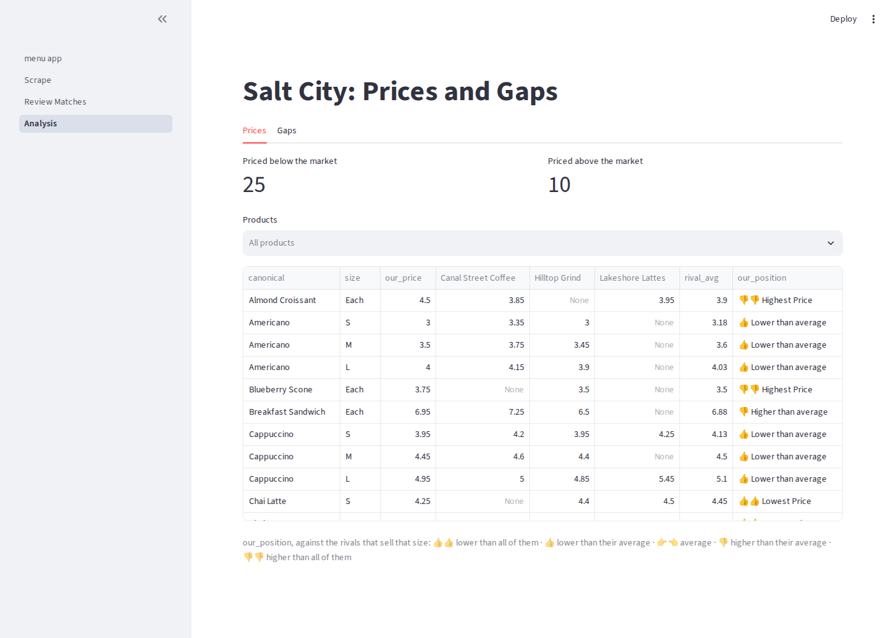

# IST356 Assignment 07 — What Is Everyone Else Charging?

Salt City Coffee is about to raise prices, and the owner wants to know where she
stands first. Three cafés nearby sell what she sells — **Lakeshore Lattes**, **Hilltop
Grind** and **Canal Street Coffee** — and their menus are on their websites. None of them
offers a download.

So you'll build one. You will **scrape** the three menus into one dataset, **match** their
items to ours (Hilltop's "Latte, Mocha" and Canal Street's "Mochaccino" are both our
"Mocha Latte" — but "Matcha Latte" isn't), and **analyze** the
result: which of our prices are above or below the market, what we sell that nobody else
does, and what all three rivals sell that we don't. It ends as a three-page Streamlit app
the owner can run again next month.

This is Unit 5 in one assignment: selectors and Playwright (5-1), next elements, tables
and driving a page (5-2), crawling and Streamlit with Playwright (5-3), and a
search-then-scrape site (5-4).

> **Plan for 6–12 hours, depending on your skill set, and start early.** This
> assignment is complex because it is
> realistic: it is what businesses really do — collect competitors' data from websites
> built for people, not programs, reconcile names that don't quite match, and turn it
> into a decision. Each café's site is built differently, so each scraper is its own
> small puzzle, and the matching step needs your judgment as well as code. Work through
> it in the order below, commit after each part, and submit early — GraderThan's
> feedback tells you which part to fix before you build on it. Expect the Canal Street
> scraper and `match_items` to take the longest.

## Meta

### Learning Objectives

By the end of this assignment you will be able to:

1. **Inspect a web page and write CSS selectors** for what you need — by class, by id, by hierarchy, and by sibling (`~`)
2. **Scrape with Playwright**: `query_selector_all`, `inner_text`, `get_attribute`, and `pd.read_html` for tables
3. **Drive a page built by JavaScript** — choose from a dropdown, click buttons, *wait* for content, page through "Show more" — and **crawl** to the pages its links point to
4. **Clean scraped text** into values a DataFrame can hold, and **reshape** wide tables to long with `melt`
5. **Run a scraper from Streamlit** in its own process
6. **Match names that don't line up** with fuzzy matching: normalize, score with `rapidfuzz`, and decide what to do at each score
7. **Keep a human in the loop**: write the matching functions behind a review tool that asks a person only what the code can't decide, and saves the answers
8. **Compare and find gaps** with pandas — `pivot_table`, row-wise `min`/`mean`/`max`, and `merge(indicator=True)`

### Assignment Layout

- `code/` — **where you write code.** Only files in this folder are reviewed for grading.
  - `rivals/` — the package
    - `__init__.py`, `settings.py`, `runner.py` — **provided.** The public API; where the sites and files are; running the scraper from Streamlit
    - `cleaning.py` — **Part 1, Step 1, you write this.** Scraped text into clean values (walked through line by line)
    - `scrapers.py` — **Part 1, Step 2, you write this.** One scraper per café (the steps described)
    - `menus.py` — **Part 1, Step 3, you write this.** Everything into one dataset (**on your own**)
    - `matching.py` — **Part 2, you write this.** Which of their items are ours? (the steps described)
    - `analysis.py` — **Part 3, you write this.** Price comparison and gap analysis (**on your own**)
  - `scrape_menus.py` — **provided.** The scraper program the app runs — it calls your scrapers and `build_dataset`
  - `menu_app.py` — **provided.** The app's front page
  - `pages/` — `1_Scrape.py` and `3_Analysis.py`: **you write these** (a step-by-step algorithm is in each file). `2_Review_Matches.py`: **provided** — it runs on your matching functions
  - `explore.py` — **provided.** Runs everything one step at a time so you can debug it
  - `reflection.txt` — **where you write your reflection** (graded)
- `site/` — a copy of the three cafés' websites (the tests scrape this copy)
- `data/` — `salt_city_menu.csv` (our menu), `categories.csv`, and `item_matches.csv` (the owner's matching decisions — your review page fills it)
- `cache/` — created by your scraper: `menus.csv`. **Not committed**
- `tests/` — the automated tests; `tests/fixtures/` — a correct scrape, and a correct set of decisions
- `grader/` — the autograder used by GraderThan (you don't touch this)
- `.devcontainer/`, `.streamlit/`, `.vscode/` — container, Streamlit and editor configuration
- `README.md`, `reflection.md`, `rubric.json`, `requirements.txt`, `ruff.toml` — these instructions, reflection guidance, grading, dependencies, style rules

You write **nineteen functions** across five files — most are under ten lines; the four
cleaning functions and `match_items` are walked through line by line — and **two
Streamlit pages**. The scraper program and the Review page are provided: they run on
your functions.

### Prerequisites

Same environment as Assignments 01–06. The course container already has Playwright and
its Chromium browser; `pip install -r requirements.txt` (the container does it for you)
adds `rapidfuzz` for fuzzy matching. No API key this time.

---

## Prep — Open the assignment

Same as before: **first fork, then** open your fork in Codespaces (**Option A**) or a
local dev container (**Option B**).

1. **Fork this repository.** At the top-right of this repo's GitHub page, click **Fork**.
   You submit and are graded on *your fork*.

### Option A — GitHub Codespaces (in the browser) ⭐ easiest

1. On **your fork's** page, click **Code → Codespaces → Create codespace on main**.
2. VS Code opens in the browser, inside the course container, with Git signed in.

> Stop your Codespace when you're done (`github.com/codespaces` → **⋯ → Stop codespace**) —
> the free hours are monthly.

### Option B — Your own computer (local dev container)

1. Clone **your fork** (`Ctrl+Shift+P` → **Git: Clone**, or
   `git clone https://github.com/YOUR-GITHUB-USERNAME/assignment_07.git`).
2. **File → Open Folder** → `assignment_07` → **Reopen in Container**.

### Check you're ready

Open the **Testing** panel and run the tests ([Reference #9](#9-how-do-i-run-automated-tests)).
You should see **0 passing and 71 failing** — every test is about a function or page you
haven't written yet.

---

## About the data — read this before you start

### The three rivals

They are published at **https://ist356.github.io/coffee-rivals/** — open each one in
Chrome, right-click what you need, and choose **Inspect** ([Reference #1](#1-how-do-i-find-a-selector)).
The same files are in `site/`; the tests serve that copy from your machine.

| café | how its menu is built | what you'll use |
| --- | --- | --- |
| **Lakeshore Lattes** | a heading per section, a note under it, then a grid of cards. Each card has a photo (you don't need it), a name, sometimes a **NEW!** badge and dietary tags (**V**, **GF**), a price line like `S $3.90 · L $5.10` (drinks) or `$8.50` (food), and a description | `query_selector_all`, the `~` sibling selector, `inner_text`, cleaning text |
| **Hilltop Grind** | inside `<div id="menu">`, an `<h2>` and a `<table>` per category: **Item**, **Description**, then an **S**, **M** and **L** column for drinks or one **Each** column for food | an id selector, `pd.read_html`, `melt` |
| **Canal Street Coffee** | an order-ahead app. **Nothing is in the HTML** until you choose a shop and click **Show full menu**; items load six at a time behind **Show more**, slowly; the list shows names only — each item links to its own page with a table of its sizes and prices | `select_option`, `click`, waiting, `get_attribute("href")`, visiting each link |

Every café uses the same size names — **S**, **M**, **L** for drinks, **Each** for food —
though not every café sells every size: Lakeshore pours only S and L. The cafés, menus
and prices are made up for this course.

### One dataset

Every scraper returns rows in its café's own words. `build_dataset` makes them one table,
with our own menu (`data/salt_city_menu.csv`) on top:

| column | example | |
| --- | --- | --- |
| `cafe` | Hilltop Grind | |
| `category` | Espresso Drinks | the café's own section name |
| `kind` | drink | from `data/categories.csv` — drink or food |
| `item` | Latte, Mocha | the café's own name |
| `size` | M | S, M or L for drinks; Each for food |
| `price` | 5.05 | |

A correct scrape of all three cafés is **144 rows**, one per item and size: 43 of ours,
37 Lakeshore, 40 Hilltop, 35 Canal Street. `tests/fixtures/menus.csv` is exactly that file.

### The names don't line up

Most of their names are ours with a twist that normalizing undoes — these match
automatically:

| theirs | ours | the twist |
| --- | --- | --- |
| Cappucino (Hilltop) | Cappuccino | a spelling slip — scores 95 |
| Americano, Iced · Latte, Mocha (Hilltop) | Iced Americano · Mocha Latte | word order |
| Café Latte, Caffe Latte | Latte | an accent, a filler word |
| Cold-Brew Coffee (Lakeshore) | Cold Brew | punctuation, a filler word |

The rest need a person:

| theirs | ours | what makes it hard |
| --- | --- | --- |
| Brewed Coffee (Canal Street) | Drip Coffee | different words for the same thing |
| Mochaccino (Canal Street) | Mocha Latte | scores 70 against *Cappuccino*, 48 against Mocha Latte |
| PSL (Canal Street) | Pumpkin Spice Latte | an abbreviation — scores 18 |
| **Matcha Latte** | — | scores **87** against Mocha Latte. It is a different drink |
| **Nitro Cold Brew**, **Cortado** | — | look like our Cold Brew and Oat Milk Cortado; they aren't |
| **Avocado Toast**, **London Fog**, … | — | we don't sell them — someone has to say so once |

On the first scrape the matcher handles **28 of the 46** rival items on its own and
leaves **18** for the owner; once she has answered **12** questions, the rest follow
automatically (Canal's Matcha Latte matches Lakeshore's, once that one has a name).
No score gets all of these right — [Reference #6](#6-how-does-fuzzy-matching-work).
`tests/fixtures/item_matches.csv` holds her 12 correct answers.

---

## Walkthrough — Do the assignment step by step

### How much help you get

| file | what you get |
| --- | --- |
| `cleaning.py`, and `match_items` in `matching.py` | a **How to build it** that is nearly line by line |
| `scrapers.py`, the rest of `matching.py` | the steps described in words |
| `menus.py`, `analysis.py` | the contract and nothing else |
| the Scrape and Analysis pages | the imports, then the page's algorithm as numbered comments |
| `scrape_menus.py`, the Review page | provided whole — read them, run them |

### Build order at a glance

| order | write this | turns green |
| --- | --- | --- |
| 1 | `clean_price`, `clean_card_lines`, `parse_price_line`, `card_rows` | `test_unit.py -k "clean or parse or card"` |
| 2 | `scrape_lakeshore`, `scrape_hilltop`, `scrape_canal` | `test_pipeline.py -k "lakeshore or hilltop or canal"` |
| 3 | `menus_table`, `add_kinds`, `build_dataset` | `test_pipeline.py -k "menus_table or add_kinds or build"` |
| 4 | `pages/1_Scrape.py` (`scrape_menus.py` is provided — it works once steps 2–3 do) | `test_pipeline.py -k "script or scrape_page"` |
| 5 | `normalize_name`, `top_candidates`, `match_band`, `record_decision` | `test_unit.py -k "normalize or candidates or band or record"` |
| 6 | `match_items` — the provided Review page then works | `test_pipeline.py -k "match_items or review_page"` |
| 7 | `add_canonical`, `price_position`, `compare_prices`, `gap_analysis`, then `pages/3_Analysis.py` | `test_unit.py -k position` and `test_pipeline.py -k "canonical or compare or gap or analysis_page"` |
| 8 | *(structure checks go green along the way)* | `test_code.py` |
| 9 | `reflection.txt` | — |

Parts 2 and 3 are tested on the files in `tests/fixtures/`, so they pass when *that*
part is right, even if your scrapers aren't finished.

### Step 1 — Look before you code

Open https://ist356.github.io/coffee-rivals/ and visit all three cafés. On each, right-click
an item → **Inspect**, and find the elements the "About the data" table names. Read
`code/rivals/settings.py`: `cafe_url()` gives each café's address, and `SITE_URL` is the
one thing the tests change.

### Step 2 — Part 1: clean the text (`cleaning.py`)

Four small functions, walked through line by line. They are plain Python — no browser — so
`pytest tests/test_unit.py -k "clean or parse or card"` checks them in under a second.

### Step 3 — Part 1: the scrapers (`scrapers.py`)

One function per café; follow each **How to build it**. Do them in order — Lakeshore
(selectors), Hilltop (tables), Canal Street (driving a page). For Canal Street, let
`playwright codegen` write the clicks for you ([Reference #3](#3-how-do-i-drive-a-page-and-wait-for-it)).
Run `code/explore.py` to see what each scraper returns and a screenshot of where it ended
([Reference #8](#8-how-do-i-debug-a-scraper)).

### Step 4 — Part 1: one dataset (`menus.py`), then run the scraper program

`menus.py` is on your own: the docstrings are the spec, and you have done every piece of
it before (a DataFrame from a list of dicts, one-sided merges, `concat`). Then run the
provided `scrape_menus.py` from a terminal at the repository root —
`python code/scrape_menus.py` — and open `cache/menus.csv`. Read it first: it is the
glue that calls your three scrapers and `build_dataset`, so when it fails, the error
points at one of your functions.

### Step 5 — Part 1: the Scrape page

Open `code/pages/1_Scrape.py` and write the code under each numbered comment. To see it,
open **`code/menu_app.py`** and run it ([Reference #7](#7-how-do-i-run-the-app)) — the
pages appear in the sidebar. Click **Scrape**.

### Step 6 — Commit and get early feedback

Commit `part 1: scrape`, push, and submit to GraderThan
([Reference #12](#12-how-do-i-submit-for-grading--and-review-my-feedback--with-graderthan)).

### Step 7 — Part 2: matching (`matching.py`), then use the Review page

`normalize_name`, `top_candidates`, `match_band` and `record_decision` are short; the
docstrings describe each step. `match_items` is the hardest function in the assignment,
so its **How to build it** is line by line — read it, and
[Reference #6](#6-how-does-fuzzy-matching-work), before you start.

The Review page (`code/pages/2_Review_Matches.py`) is **provided**: it calls your
`match_items`, `match_band` and `record_decision`, so it works when they do. Read it —
it shows `st.session_state` remembering what you skipped. Then **use it**: answer all 12
questions the way the owner would, and commit `data/item_matches.csv` with your code.

### Step 8 — Commit

Commit `part 2: matching`, push, submit.

### Step 9 — Part 3: analysis (`analysis.py`) and the Analysis page

On your own. `price_table` is provided — it is the `pivot_table` everything else starts
from: one row per item and size, one column per café. `compare_prices` keeps that
shape — our price, then each rival's — and adds two columns: the rivals' average
(`.mean(axis=1)` across the rival *columns*) and an **our_position** for each row from
`price_position`:

| our_position | name in `settings.py` | when |
| --- | --- | --- |
| 👍👍 Lowest Price | `BELOW_ALL` | our price is lower than every rival's |
| 👍 Lower than average | `BELOW_AVERAGE` | lower than the rivals' average, but not lower than all of them |
| 👉👈 Average | `AT_AVERAGE` | equal to the rivals' average |
| 👎 Higher than average | `ABOVE_AVERAGE` | higher than the average, but not higher than all of them |
| 👎👎 Highest Price | `ABOVE_ALL` | higher than every rival's |

Return the **names** (`return BELOW_ALL`), not the text — the labels start with
emoji, which are easy to mistype.

`gap_analysis` is an outer merge with `indicator=True` ([Reference #10](#10-how-do-i-find-gaps-with-a-merge)).
Then the Analysis page: two cards, a **Products** filter (pick none to see everything),
and the price table.

When everything is reviewed, the app should show **25** prices below the market and
**10** above (one per item and size; 👉👈 Average counts as neither), and **8** items
only the rivals sell — avocado toast at all three.



### Step 10 — Commit

Commit `part 3: analysis`, push, submit.

### Step 11 — Reflection, then final submit

Write `code/reflection.txt` (see `reflection.md`). Commit, push, and submit one last time.

---

## Reference — How do I…?

### 1. How do I find a selector?

Right-click the thing you want → **Inspect**. The Elements panel highlights its HTML.
Look for a `class` or `id` that names *what it is* (`menu-card`, `menu`), not how it
looks. Then check your selector in the Console tab before you write Python:
`document.querySelectorAll("article.menu-card").length`.

| you want | selector |
| --- | --- |
| elements with a class | `article.menu-card` |
| the element with an id | `#menu` |
| elements inside another | `#menu h2` (any depth), `article.menu-card h3` |
| the **next** sibling of this element (lesson 5-2) | `~ *` |
| the next sibling **that is a** `div.menu-grid` | `~ div.menu-grid` |

`element.query_selector(...)` searches *from* that element — that is how `~` works: it
starts at the heading you already found.

### 2. How do I scrape text and attributes?

```python
page.goto(url)
for card in page.query_selector_all("article.menu-card"):
    card.inner_text()                           # what a person sees
for link in page.query_selector_all("a.result-card"):
    link.get_attribute("href")                  # an attribute: "item.html?id=latte&shop=..."
urljoin(page.url, "item.html?id=latte")         # -> the full address
page.inner_text("#item-name")                   # one element's text, by selector
```

`inner_text()` returns text the way the page *shows* it, line breaks included — which is
why Lakeshore's cards need `clean_card_lines`.

### 3. How do I drive a page, and wait for it?

Run `playwright codegen https://ist356.github.io/coffee-rivals/canal/` in a terminal,
click through the page in the window that opens (choose a shop, click **Show full menu**),
and copy the lines it records:

```python
page.get_by_label("Choose your shop").select_option("Westcott")
page.get_by_role("button", name="Show full menu").click()
```

Canal Street draws its cards with JavaScript *after* the click, so the next line must
**wait**: `page.wait_for_selector("a.result-card")`. `query_selector_all` does not wait —
call it too early and it returns an empty list, with no error. For **Show more**, count the
cards first and wait until there are more:

```python
page.wait_for_function(f"document.querySelectorAll('a.result-card').length > {count}")
```

(`codegen` needs a screen. In Codespaces it can't open its window — use it on your own
computer, or read the selectors from Inspect instead.)

### 4. How do I crawl the links I scraped?

Collect every `href` first, *then* visit them — leaving the page throws away the cards
you were looping over:

```python
links = [a.get_attribute("href") for a in page.query_selector_all("a.result-card")]
for href in links:
    page.goto(urljoin(base_url, href))       # "item.html?id=latte" -> a full address
```

### 5. How do I read HTML tables, and reshape them with melt?

`pd.read_html` finds every `<table>` in a page's HTML and returns a list of DataFrames,
in page order — Hilltop's whole menu in one line:

```python
tables = pd.read_html(StringIO(page.content()))   # page.content() is the page's HTML
```

The table doesn't say which category it is — the `<h2>` above it does. The headings and
the tables come in the same order, so `zip()` pairs them up.

Hilltop's drink tables have a column per size. `melt` turns those columns into rows:

```python
long = table.drop(columns="Description").melt(id_vars="Item", var_name="size",
                                              value_name="price")
#    Item         S      M      L               Item         size  price
#    Drip Coffee  $2.15  $2.60  $3.05    ->     Drip Coffee  S     $2.15
#                                               Drip Coffee  M     $2.60
#                                               Drip Coffee  L     $3.05
```

A food table has one **Each** column, so the same `melt` gives one row per item, size
"Each".

### 6. How does fuzzy matching work?

`rapidfuzz` scores how alike two strings are, 0–100. `fuzz.token_sort_ratio` sorts the
words first, so word order doesn't matter:

```python
from rapidfuzz import fuzz, process
fuzz.token_sort_ratio("croissant almond", "almond croissant")       # 100
process.extract("matcha latte", ["mocha latte", "latte", "chai latte"],
                scorer=fuzz.token_sort_ratio, limit=3)
# [('mocha latte', 87.0, 0), ('latte', 58.8, 1), ('chai latte', 45.5, 2)]   (rounded)
```

Three ideas make it work on menus:

1. **Normalize first.** Lowercase, drop accents and punctuation, and drop words that
   don't tell items apart (`FILLER_WORDS`: "caffe", "coffee", "hot"…). "Caffè Latte" and
   "Latte" are then both `latte`, and score 100.
2. **Compare like with like.** Drinks with drinks, food with food (`kind`).
3. **Decide what each score means.** At `AUTO_MATCH` (90) or more, match without asking.
   Below it, ask the owner — and *suggest* the best candidates, with their scores. A
   score measures spelling, not meaning: "matcha latte" scores 87 against "mocha latte",
   and "psl" scores 18 against "pumpkin spice latte".

The owner's answers are saved and always win, so the code never asks the same question
twice — not even after next month's scrape. That is called keeping a **human in the
loop**, and it is how real data teams match names.

### 7. How do I run the app?

Open **`code/menu_app.py`** and use **Run and Debug → Streamlit Run: Current File**, or
`streamlit run code/menu_app.py` from the repository root. Streamlit lists the files in
`code/pages/` in the sidebar. (Running a page file on its own runs that page without the
sidebar — fine for a quick look.)

`st.session_state` is a dictionary that survives the reruns Streamlit does after every
click — the Review page uses it to remember what you skipped.

### 8. How do I debug a scraper?

Run `code/explore.py` with **Python Debugger: Current File**, with a breakpoint inside the
function you are writing. It runs each scraper, prints the first rows, and saves a
screenshot of the page it ended on (`cache/lakeshore.png`, …) — the browser is invisible
in the container, so the screenshot is how you see what your code saw. To see what a page
looked like at any moment, add `page.screenshot(path="cache/look.png")`.

### 9. How do I run automated tests?

**Testing** panel (View → Testing) → ▶. Or from a terminal at the repository root:

```
pytest tests/test_unit.py -v
pytest tests/test_pipeline.py -k scrape_lakeshore      # one at a time
pytest tests/test_code.py -v
```

The scraper tests start a small web server for `site/` and an invisible browser, so they
take a few seconds each. If the Testing panel shows no tests at all,
`rivals/__init__.py` cannot import a function — a deleted or misspelled function name.
Scroll up to the `ImportError`.

### 10. How do I find gaps with a merge?

An **outer** merge keeps every row from both sides; `indicator=True` adds a `_merge`
column saying where each row came from:

```python
gaps = pd.merge(ours, theirs, on=["canonical", "kind"], how="outer", indicator=True)
gaps["_merge"]   # "left_only" (only us), "right_only" (only them), "both"
```

`_merge` is a *categorical* column — `.astype(str)` it before you relabel or sort, or the
sort follows its category order instead of yours.

### 11. How do I commit and push?

View → Source Control → message → **Commit**, then **Sync Changes**. Commit
`data/item_matches.csv` too — those are the owner's decisions. `cache/` is not committed
(`.gitignore` hides it); your scraper rebuilds it.

### 12. How do I submit for grading — and review my feedback — with GraderThan?

1. Go to **https://graderthan.cent-su.org** and log in with your SU Microsoft account.
2. Click this assignment on **Your dashboard**.
3. First time only: **Profile → Connect GitHub**.
4. Under **Request grading**, submit your fork's URL. **Commit and push first.**

### 13. How do I check my code style?

The **Code style & readability** point is four checks on everything in `code/`, and
**all four** must pass:

| check | how to see it yourself |
| --- | --- |
| no `# TODO` comments left | search `code/` for `TODO` — the starter has one in every function you write |
| no leftover `pass` stubs | every `pass` the starter left where a body goes is replaced by your code |
| a docstring on every function | keep the starter's; give any helper you add its own |
| no lint errors | run `ruff check` at the repository root — **no output means it passes** |

`ruff check` reads `ruff.toml`, which holds exactly the grader's rules. On an untouched
checkout it already reports unused imports in the files you write — the names your code
is about to use. They disappear as you write it. (Don't let `ruff check --fix` delete them.)

---

## How You're Graded

GraderThan scores this assignment out of **10 points** (see `rubric.json`):

| What | Points | Judged by |
| --- | --- | --- |
| **Unit Tests** — `test_unit.py` (cleaning, matching and `price_position`, no browser) | 2 | automated tests |
| **Pipeline & App Tests** — `test_pipeline.py` (the scrapers against the local sites, the dataset, matching, the price table and gaps, the three pages — including the Products filter; the Review page tests check your matching functions) | 3 | automated tests |
| **Code Structure Tests** — `test_code.py` (each scraper's technique, rapidfuzz, merge/groupby instead of loops, the pages assemble the package) | 2 | automated tests |
| **Code style & readability** — no `# TODO`s, no leftover `pass`, a docstring on every function, `ruff check` clean ([Reference #13](#13-how-do-i-check-my-code-style)) | 1 | automated style checks |
| Reflection quality | 2 | AI reviewer |

**Only files in the `code/` folder are graded.**
